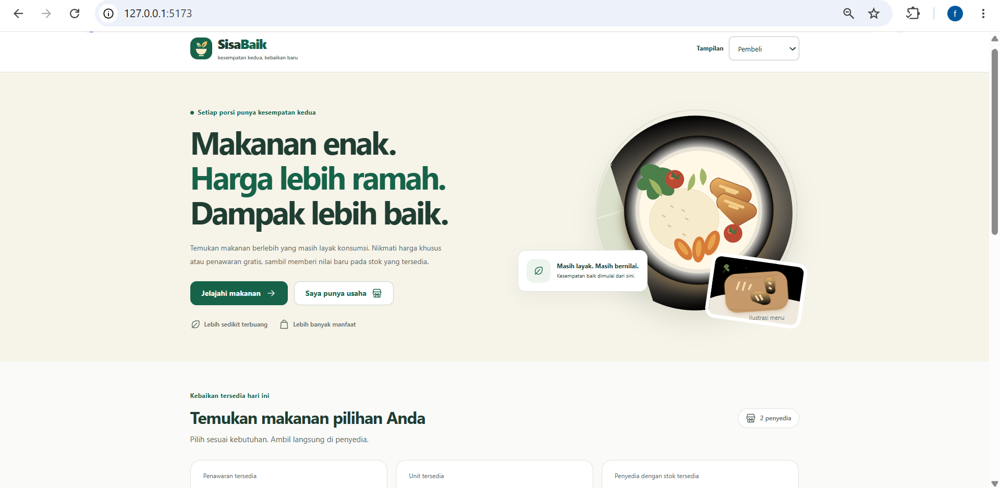
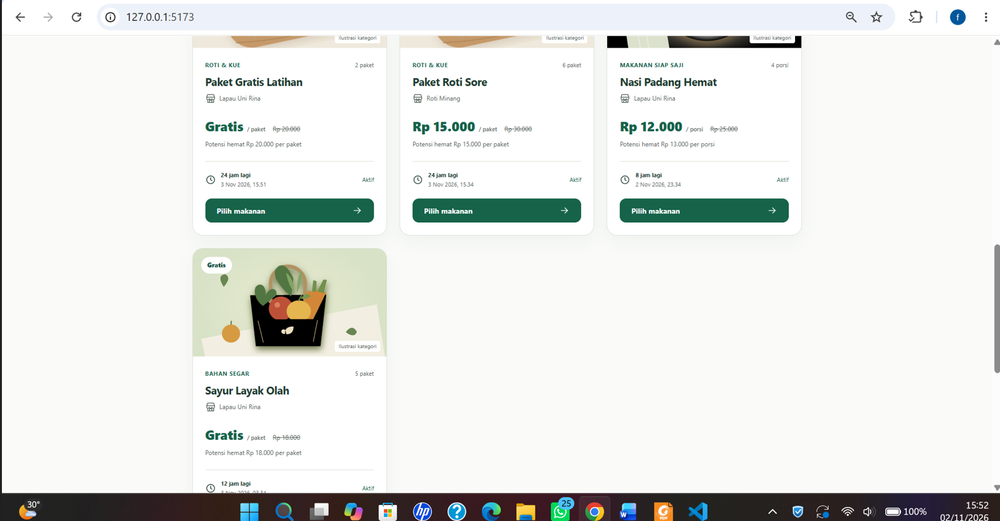
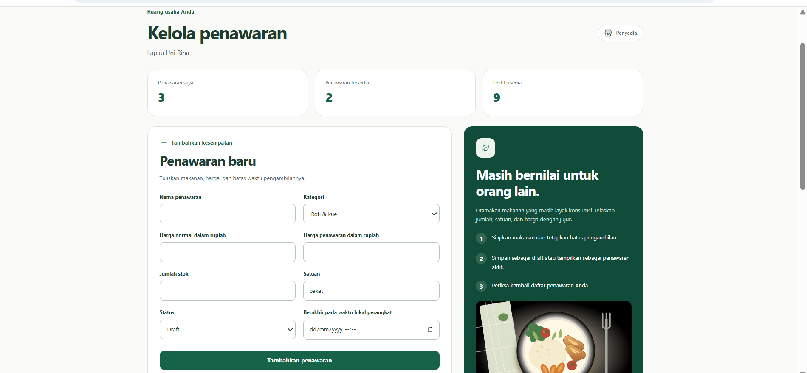
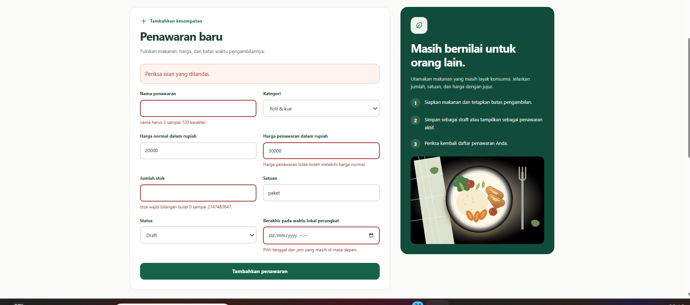

# Laporan Hasil Uji - Chapter 9: Membangun Antarmuka dengan Vue

## Identitas Pengujian
* **Nama Mahasiswa**: Faniya Syafira
* **Program Studi**: Bisnis Digital (Universitas Negeri Padang)
* **Mata Kuliah**: Pengembangan Web 
* **Tanggal Pengujian**: November 2026

---

## 1. Ringkasan Pengujian Fungsional Skenario
Berikut adalah hasil aktual dari pengujian skenario komponen Vue yang dijalankan melalui server lokal Vite:

* **Halaman Awal (Mode Pembeli)**: Berhasil memuat 3 kartu penawaran awal, 15 unit total tersedia, dan 2 penyedia aktif. Penawaran *Sayur Layak Olah* tampil dengan label **Gratis**. Kemudian ditambahkan 1 kartu dari webnya langsung tetapi jika di refresh akan kembali seperti semula, karna hanya tersimpan sementara, tidak tersimpan di database.
  
  > 

  > 

* **Pencarian & Filter**: Pencarian teks "LAPAU" berhasil menyaring 2 kartu penawaran dari *Lapau Uni Rina*. Pemilihan kategori *Roti & kue* berhasil memperbarui tampilan katalog menjadi 1 kartu (*Paket Roti Sore*).

* **Interaksi Kartu**: Mengklik tombol "Pilih makanan" memicu *event* anak ke induk, memindahkan fokus ke panel ringkasan pilihan, tanpa mengubah stok asli pada backend/database.

* **Mode Penyedia (Penyedia Rina)**: Berhasil menampilkan panel ruang usaha Rina dengan 3 total penawaran (termasuk 1 status *draft*).
  
  > 

* **Validasi Formulir**: 
  * Formulir kosong yang langsung disubmit berhasil ditolak, memunculkan pesan kesalahan, dan memindahkan fokus aksesibilitas ke area pemberitahuan kesalahan (*notice*).
  * Validasi harga menolak ketika harga penawaran diisi lebih tinggi dari harga normal.
  * Penambahan data valid (dengan harga penawaran `0` atau gratis) berhasil diterima, menampilkan pesan sukses, mengosongkan form kembali, dan menambah jumlah data di daftar milik Rina.
  
  > 

* **Sifat Memori State**: Setelah halaman di-*refresh*, data penambahan baru hilang dan kembali ke 3 fixture awal, membuktikan bahwa data ini tersimpan sementara di memori *state* frontend.

---

## 2. Pengujian Aksesibilitas & Responsivitas
* **Responsivitas Perangkat**: Diuji menggunakan browser DevTools pada ukuran layar **375px (Mobile)**, **768px (Tablet)**, dan **1280px (Desktop)**. Tata letak responsif dengan baik dan tidak ditemukan adanya *scroll* horizontal yang merusak tampilan.
* **Navigasi Keyboard**: Pengujian menggunakan tombol `Tab` / `Shift+Tab` serta tautan cepat *Lewati ke konten* berfungsi dengan baik; penanda fokus (*focus-visible*) terlihat jelas.

---

## 3. Hasil Build & Preview Vite
* **Proses Build (`npm run build`)**: Berhasil mengkompilasi file Vue dan menghasilkan folder `frontend/dist` yang berisi `index.html` dan aset terbundel.
* **Pratinjau Lokal (`npm run preview`)**: Berhasil menyajikan aplikasi di `http://127.0.0.1:4173/` dengan seluruh komponen berjalan lancar.